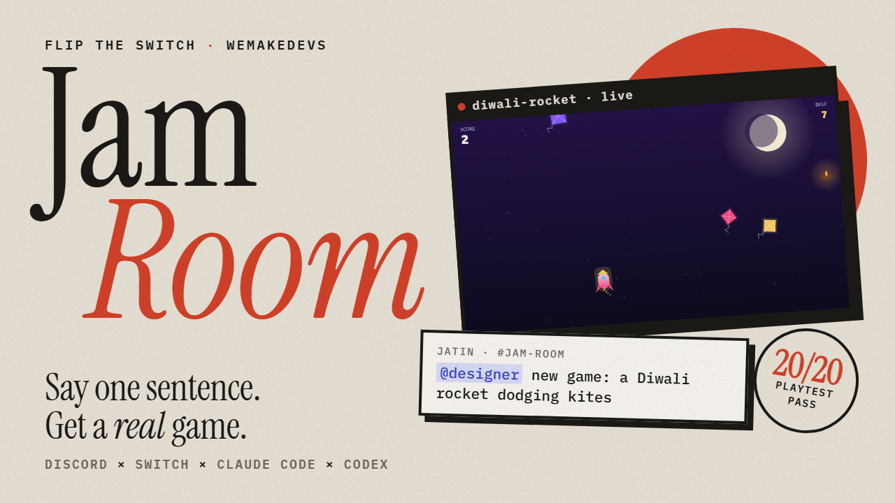
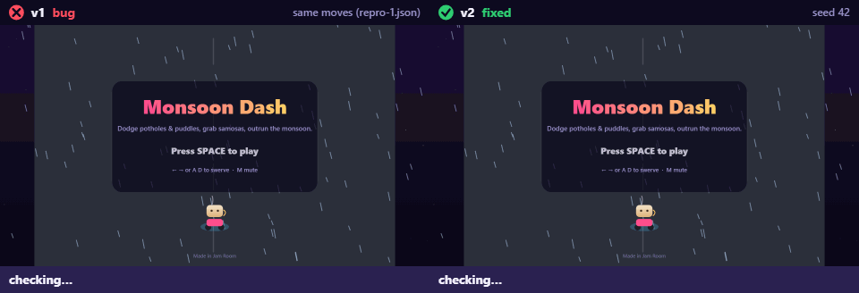
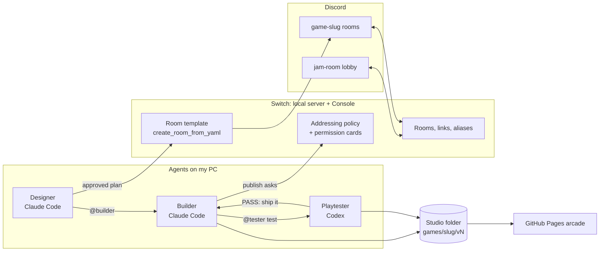
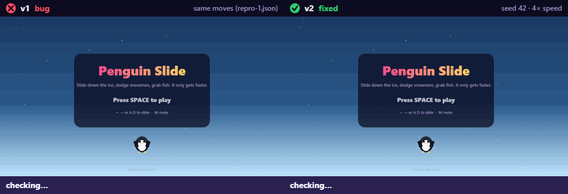

# Jam Room

**Friends make tiny browser games just by chatting in Discord.** Three Switch agents become the
group's teammates: a designer (Claude Code) turns everyone's ideas into a plan, a builder
(Claude Code) writes the game on your own PC, and a playtester (Codex · OpenAI) plays it in a
real browser. Nothing goes public until a human taps Allow on Switch's permission card.

[](https://github.com/jatinvats123/jam-room/actions/workflows/verify.yml)


| ▶️ Watch the demo | 🎮 Play the arcade | ✅ Check every claim | ⚡ Remove Switch and this breaks |
|---|---|---|---|
| [YouTube (6 min)](https://youtu.be/M0vdHaCSV5Q) | [jam-studio-arcade](https://jatinvats123.github.io/jam-studio-arcade/) | [Option A](#option-a-check-every-claim-in-about-3-minutes-no-discord-no-switch-no-keys) · `npm run verify` (20/20, no Discord needed) | [docs/SWITCH_FEATURES.md](docs/SWITCH_FEATURES.md) |

[](https://youtu.be/M0vdHaCSV5Q)

Built for the **Flip the Switch** hackathon (WeMakeDevs × Switch) · **Track 02: Best Personal or
Creative Workflow** · built by voice with **Wispr Flow**.

**Contents:** [The problem](#the-problem) · [Demo](#demo) · [What happens](#what-happens-the-real-run-from-the-demo-nov-7) ·
[How Switch is used](#how-switch-is-used) (agents, channel setup, why it's essential, architecture) ·
[How to run it](#how-to-run-it) · [Features](#features) · [Repo layout](#repo-layout) ·
[Limits](#limits-and-honest-notes)

## The problem

Every friend group has game ideas ("a chai cup on a scooter dodging potholes!"), and they die in
the group chat because nobody has time to build them. Jam Room turns AI agents into teammates
**inside the chat the friends already use**: the people pitch, approve, playtest and report bugs;
the agents plan, build, test, fix and ship. The real task gets done: a playable game with a
link, versions, bug fixes and credit for everyone who helped.

**Who it's for:** friend groups and game-night Discord servers, and kids or students learning
game design by watching the agents work and asking them how things work.

## Demo

[Watch on YouTube](https://youtu.be/M0vdHaCSV5Q) (6 min). Chapters:

| Time | What you see |
|---|---|
| [0:00](https://youtu.be/M0vdHaCSV5Q?t=0) | Intro: what Jam Room is and why Switch is central |
| [0:31](https://youtu.be/M0vdHaCSV5Q?t=31) | Switch Console: the agents, their providers, the builder's addressing rule |
| [1:26](https://youtu.be/M0vdHaCSV5Q?t=86) | A game pitched by voice in the Discord lobby |
| [2:03](https://youtu.be/M0vdHaCSV5Q?t=123) | The designer's plan, and a human `approve` |
| [2:24](https://youtu.be/M0vdHaCSV5Q?t=144) | Switch creates `#game-diwali-rocket` from a room template |
| [2:42](https://youtu.be/M0vdHaCSV5Q?t=162) | The builder (Claude Code) hands off to the playtester (Codex) by @mention |
| [3:11](https://youtu.be/M0vdHaCSV5Q?t=191) | PLAYTEST PASS, a GIF of the test run, and Switch's permission card |
| [3:38](https://youtu.be/M0vdHaCSV5Q?t=218) | Live, plus the "Now playing" note posted back in the lobby |
| [4:11](https://youtu.be/M0vdHaCSV5Q?t=251) | A non-approver is blocked by Switch; anyone can ask "explain" |
| [4:42](https://youtu.be/M0vdHaCSV5Q?t=282) | A friend's bug with a phone screenshot → reproduced → hotfix v2 |
| [5:30](https://youtu.be/M0vdHaCSV5Q?t=330) | The arcade, "How this game was made" pages, `npm run verify` |

## What happens (the real run from the demo, Nov 7)

1. **Pitch by voice.** In the `#jam-room` lobby I said, through Wispr Flow: *"@designer new game:
   a Diwali rocket climbs into the night sky, dodging kites and grabbing diyas for points."*
2. **Plan, then a human approves.** The designer replied with controls, scoring and an
   acceptance checklist. Nothing is built until someone replies `@designer approve`.
3. **A room per game.** The designer called Switch's `create_room_from_yaml` with
   [`templates/jam-game-room.template.yaml`](templates/jam-game-room.template.yaml): a new
   Discord channel `#game-diwali-rocket` appeared with all three agents, their short names and a
   kickoff that hands the builder its job. The lobby got a link to it.
4. **Build → handoff → test.** The builder (Claude Code) wrote one HTML file, then
   `@jam-playtester-gpt please test diwali-rocket v1`. Switch delivered the mention and woke the
   Codex playtester, which played the game headlessly against the checklist: **PASS 18/18,
   61 fps**, and posted a GIF of its own test run through Switch.
5. **Human approval → live.** The builder's publish command triggered a Claude Code permission
   request, which Switch shows as a **Permission needed** card in Discord. Only approvers can
   answer it. One tap on Allow, and the game was live on GitHub Pages, with a "Now playing" note
   posted back in the lobby (a cross-room post).
6. **Rules enforced by Switch.** A second Discord account ("Rohan", playing a friend who isn't an approver) typed `@builder ship it` and got
   Switch's own refusal before the agent saw it. The same account asked the designer
   *"explain how do the kites move?"* and got a plain answer.
7. **Bug → reproduced → hotfix.** In `#game-monsoon-dash` "Rohan" sent a phone screenshot:
   *"my scooter rides off the road onto the sidewalk"*. The playtester replayed it, saved it as
   `repro-1.json`, posted a ❌ clip, and handed the hotfix to the builder. v2 passed **20/20**
   and went live with a side-by-side clip and a 🐛 bug hunter credit:



## How Switch is used

Jam Room has **no server of its own**. Switch is where the people and the agents meet, how the
agents hand work to each other, and what enforces who may ship. Remove it and all that is left is
a folder of HTML files ([full map with file:line references](docs/SWITCH_FEATURES.md)).

### Agents connected

All of them are Console-managed agents on my PC, sharing one working folder (the studio).

| Agent (short name) | Runs on | Its job | Who can talk to it (Switch addressing) | What it writes |
|---|---|---|---|---|
| `jam-designer` (`@designer`) | Claude Code | Turns ideas into a spec with an acceptance checklist, waits for a human `approve`, creates the game's room from the template, credits people, answers "explain" | **Anyone** | `games/<slug>/GAME_SPEC.md`, `people.json` |
| `jam-builder` (`@builder`) | Claude Code | Writes each version as one HTML file, hands it to the tester, publishes after a PASS (which raises the permission card) | **Custom rule: me + named approvers + my agents.** Switch refuses everyone else | `games/<slug>/v<N>/index.html`, `NOTES.md` |
| `jam-playtester-gpt` (`@tester`) | **Codex (OpenAI)** | Writes a scenario from the checklist, plays the game headlessly, reports PASS/FAIL, turns `bug:` reports into saved repro tests, posts GIF clips | **Anyone** (humans may only report bugs; test requests come from agents) | `scenario.json`, `playtest.json`, `repro-<k>.json`, GIFs |
| `jam-playtester` (fallback) | Claude Code | The same job where Codex isn't installed (`tester_provider: [codex, claude]`) | Anyone | same |

The exact instructions pasted into each agent are in
[docs/live-agent-instructions.md](docs/live-agent-instructions.md), generated from the templates
by `scripts/live-instructions.mjs` (`--check` proves they still match).

### How the channel is set up

```text
Discord server ──(Switch Discord connector, bot "Jam Room Switch")──► Switch server on my PC
  #jam-room      = Switch room "jam-room": the lobby (templates/jam-room.template.yaml)
  #game-<slug>   = one Switch room per game, created by the designer from
                   templates/jam-game-room.template.yaml after a human approves
```

1. **Switch server + Console 0.40.1** run on the same PC as the agents. The Claude Code and
   Codex CLIs are signed in there (`claude auth status`, `codex login status`).
2. **Discord connector:** Console → **Connectors → Discord** links the server. Switch's bridge
   bot ("Jam Room Switch") mirrors each Switch room to exactly one Discord channel.
3. **Lobby room `jam-room`:** created from [`templates/jam-room.template.yaml`](templates/jam-room.template.yaml)
   with all three agents and the room's instructions; short names via `!set-alias` (`@designer`,
   `@builder`, `@tester`).
4. **Game rooms:** after a human approves a plan, the designer calls `create_room_from_yaml` with
   [`templates/jam-game-room.template.yaml`](templates/jam-game-room.template.yaml). Switch creates
   `#game-<slug>` with the agents, aliases, instructions and a kickoff message that starts the
   build, and links it to the lobby (plus `remix of` / `remixed as` links for remixes).
5. **What you see in Discord:** agents post in the channel. Switch puts each agent's live status
   ("Working… 27s", tool progress) and its **Permission needed** cards in a thread under the
   message that woke it.
6. **Approval:** the studio's [`.claude/settings.json`](studio-kit/.claude/settings.json) asks
   before `node tools/publish.mjs`, and Switch turns that Claude Code permission request into the
   card. Who may answer it = who may address the builder.

### Why Switch is essential (what breaks without it)

Jam Room has no server of its own: every row below is Switch doing the work. **Enforced by
Switch** means the rule holds even if an agent's instructions are ignored or rewritten. The full
map (every feature → file:line → what breaks without it, plus what Switch *doesn't* do here) is
[docs/SWITCH_FEATURES.md](docs/SWITCH_FEATURES.md).

| What happens | Switch feature | Enforced by Switch? |
|---|---|---|
| Only approvers (the host + named friends) and the owner's agents can direct `@builder`; anyone else gets *"You're not permitted to direct messages to me in this room"* | Addressing policy, custom rule (Console) | ✅ Switch refuses before the agent sees it |
| Only approvers can answer the 🚀 publish card, so nothing goes public without one | Approval requests (who may answer = who may address) | ✅ Switch |
| A game goes public only after a human taps Allow | Claude Code permission → "Permission needed" card in Discord | ✅ Switch + the studio's `.claude/settings.json` ask rule |
| Credits and "bug hunter" names follow the person, not the name they type | Stable sender ids from `read_context` / `list_participants` → `people.json` | ✅ ids come from Switch; the name each id maps to is the designer's job |
| Each approved game gets its own channel, aliases and kickoff | Agent-run room templates (`create_room_from_yaml`) | ✅ Switch |
| Lobby ↔ game ↔ remix navigation | Room links | ✅ Switch |
| Designer → builder → playtester handoffs | @mention addressing between agents | ✅ Switch delivers; who hands off when is in the instructions |
| Claude Code builds, Codex (GPT) tests, on your own PC | Console-managed agents, two providers | ✅ Switch |
| Plans need a human `approve`; only agents may ask for a `test` | Instructions | ❌ prompt (Switch can't tell a message's intent apart) |

### Architecture



Switch is the only server. Agents talk to people and to each other only through Switch rooms;
the studio folder is plain files (spec, `index.html` per version, scenario, playtest result,
clips), and `tools/publish.mjs` pushes it to GitHub Pages.

## How to run it

### Option A: check every claim in about 3 minutes (no Discord, no Switch, no keys)

```bash
git clone https://github.com/jatinvats123/jam-room && cd jam-room
npm ci
npx playwright install chromium
npm run verify      # 20 claims, one PASS/FAIL line each; exit code 0 = all pass
```

It replays the three real agent-made games in [examples/games/](examples/games/): static checks,
headless playtests, the saved bug repro failing on v1 and passing on the hotfix, a remix, both
Switch templates parsing, and byte-identical GIF clips. CI runs it on every push.

### Option B: run the whole studio (Switch + Discord)

Tested with **Switch Console 0.40.1** (core 0.31.0), **Node 20+**, Git, **Codex CLI 0.166.0**,
**Playwright 1.64.1** (pinned in the studio's package.json), and a Discord connection set up in
Console (**Connectors → Discord**, see [How the channel is set up](#how-the-channel-is-set-up)).

1. **Studio folder** (where the agents work; published as the arcade):
   ```powershell
   powershell -ExecutionPolicy Bypass -File scripts\setup-studio.ps1   # Windows → %USERPROFILE%\jam-studio
   ```
   ```bash
   ./scripts/setup-studio.sh                                            # macOS / Linux → ~/jam-studio
   ```
   It copies `studio-kit/` and `templates/jam-game-room.template.yaml`, downloads headless
   Chromium (~700 MB) into `<studio>\.browsers` for the playtester, and makes the folder a git
   repo. Safe to re-run. Pick another folder with `-Target <dir>` (PowerShell) or the first
   argument (setup-studio.sh); the default is `%USERPROFILE%\jam-studio`.
2. **Codex CLI** (for the GPT playtester):
   ```powershell
   npm i -g @openai/codex
   codex login        # a ChatGPT login works, or use an API key
   ```
   Console should then show "Codex · Signed in". Without Codex the template's playtester falls
   back to Claude Code.
3. **Agents and the lobby room:** in Console, Templates → create from
   `templates/jam-room.template.yaml`, pick your Discord connection and the studio folder.
   - **Windows:** Console 0.40.1 can't create Claude Code agents from a template there, so first
     create the agents by hand (Your Agents → +, directory = the studio):
     `jam-designer` and `jam-builder` (Claude Code), and `jam-playtester-gpt` (provider Codex,
     Who can talk = Anyone). Generate the copy-paste instructions for that set:
     ```powershell
     node scripts/live-instructions.mjs --tester jam-playtester-gpt
     ```
     Paste each block from [docs/live-agent-instructions.md](docs/live-agent-instructions.md) and
     set its Addressing as shown. Then run the template and choose **Existing agent** for all
     three.
   - **Approvers (any OS):** the template gives the builder `owner-agents`. To let a friend
     publish too, open Your Agents → `jam-builder` → Who can talk to this agent → **Custom**,
     one rule: Rooms Any, Room groups Any, Users **Specific** = Me + the friend's chat
     username, Agents = My agents. Everyone else who @mentions the builder is refused by
     Switch and can't answer its publish card.
4. **Short names:** post one ordinary message in the new `#jam-room` channel, then:
   ```text
   !set-alias @jam-designer @designer
   !set-alias @jam-builder @builder
   !set-alias @jam-playtester-gpt @tester
   ```
   (Game rooms get these aliases automatically from their template; the designer passes the
   playtester's name, so `@tester` points to the GPT agent there too.)
5. **Play:** `@designer new game: a penguin sliding down an icy hill, dodging snowmen` → reply
   `approve` → the designer opens `#game-<slug>`, where the builder builds, the playtester
   tests, and an approver Allows the "Permission needed" card to publish. In the web client type
   the card's answer (e.g. `A1 1`) instead of clicking. A playtest passes only after the
   playtester writes `games/<slug>/v<N>/scenario.json` from the spec's Acceptance list; a cold
   first run can take up to ~150 s.
6. **Public links (optional):** add a GitHub remote to the studio and enable GitHub Pages
   (main, root). Without one, links are local: run `npm run serve` in the studio and open
   http://localhost:8080/.

After editing agent instructions, run `!reset-all-agents` in each room: a resumed session keeps
its old memory. After editing the template, `node scripts/live-instructions.mjs --check` confirms
`docs/live-agent-instructions.md` still matches it (on the Windows path, generate with
`--tester jam-playtester-gpt`). Gotchas and design choices: [DECISIONS.md](DECISIONS.md).

### Commands you type in Discord

- `@designer make it faster` → change list, `approve`, v<N+1>.
- `@tester bug: the penguin went through a snowman` → reproduced as a saved test → hotfix
  v<N+1> → re-tested (every saved bug test runs again on later versions) → published, with the
  reporter credited as bug hunter.
- `@designer remix Penguin Slide into a lava surfing game` → a new game that starts from the
  original's code, with its own room linked to the original (`remix of` / `remixed as`).
- `@designer explain how does the jump work?` → explain-it mode (below).

### Troubleshooting (things we actually hit)

| You see | Do this |
|---|---|
| An agent says *"Sign in on the execution machine with claude auth login"* | Run `claude auth login` on the PC, then `!reset-all-agents` in the room |
| Switch replies *"&lt;agent&gt; isn't in this room"* | You posted in a channel that isn't the Switch room, or inside a thread. Post in the room's main channel, or `!invite-agent @<agent>` |
| An agent acts on old rules after you edit its instructions | `!reset-all-agents` in each room: a resumed session keeps its old memory |
| The Allow button on the card does nothing (Discord web) | Type the card's answer instead, e.g. `A1 1`, or use the desktop app |
| `!set-alias` refuses | The alias is taken: `!remove-alias @tester` first |
| A Codex playtest fails with `spawn EPERM` on Windows | Re-run setup: it installs Chromium into the studio's `.browsers/`, which the Codex sandbox can read |
| Console says *"Cannot reach the server"* | Close and reopen Console (keep the laptop plugged in) |

More gotchas and every design decision: [DECISIONS.md](DECISIONS.md).

## Features

- **Design by chat:** the designer gathers everyone's ideas into a spec, a human replies
  `approve`, and the game gets its own `#game-<slug>` room.
- **Build, test, publish:** the builder writes one HTML file, the playtester plays it headlessly
  against the spec, and a human Allows the publish card. Links go to the arcade.
- **Cross-vendor playtesting:** the builder is Claude Code and the playtester runs on Codex (GPT)
  by default, so the model that builds never grades its own work.
- **Versions, remixes, bug hunts:** changes become v<N+1>; `bug: …` becomes a saved repro test
  and a hotfix crediting the reporter; remixes start from the original's code.
- **Caught on camera:** after a PASS the playtester posts a GIF of its own test run in Discord; a
  reproduced bug gets a ❌ clip and the hotfix a side-by-side "same moves, v1 vs v2" clip.
- **"How this game was made" pages:** a timeline per game, built only from files the agents
  already wrote.
- **Explain-it mode:** anyone can ask the designer how part of the game works.
- **Switch enforces the rules:** only approvers can direct the builder or answer its publish
  card. Anyone else gets Switch's own refusal, not a prompt's polite no.

<details>
<summary><b>More detail: caught on camera, cross-vendor playtesting, making-of pages, explain-it mode</b></summary>

### Caught on camera: another hotfix (Penguin Slide)



A friend reported in Discord that hugging the right wall dodges every snowman. This replays the playtester's saved repro on v1 (left: still alive after 30 s, the bug) and on the hotfix v2 (right: caught); the playtester posts clips like it in Discord through Switch.
Each clip is the same deterministic run as the test (seed 42, fake clock), made by [`studio-kit/tools/clip.mjs`](studio-kit/tools/clip.mjs) and checked by `npm run verify`.

### Cross-vendor playtesting

The template's `tester_provider` param defaults to `[codex, claude]`: the playtester runs on
Codex (GPT) and falls back to Claude Code where Codex isn't installed. The builder is always
Claude Code, so a second AI company's model checks every build. `playtest.json` records which
one ran it (`runner`: "GPT · Codex" or "Claude", detected from the environment each CLI sets).

**Moving an existing room to the GPT playtester** (Windows / hand-made agents): create
`jam-playtester-gpt` as in Quick start, regenerate and re-paste the instructions with
`--tester jam-playtester-gpt`, then in each room:

```text
!invite-agent @jam-playtester-gpt
!remove-alias @tester
!set-alias @jam-playtester-gpt @tester
!reset-all-agents
```

(`set-alias` refuses an alias that is already in use, hence `remove-alias` first.)

**Fallback:** run `node scripts/live-instructions.mjs` without `--tester`, re-paste the designer
and builder blocks, and point `@tester` back at `jam-playtester` (Claude).

**Gotcha:** Codex's Windows sandbox runs commands as a restricted user that can't read
`%LOCALAPPDATA%\ms-playwright`, so Chromium failed with `spawn EPERM`. Setup therefore installs
Chromium into the studio's `.browsers/` folder (gitignored), and `tools/playtest.mjs` uses it
automatically when it exists. Re-run setup if an older studio lacks `.browsers/`.

### "How this game was made" pages

`tools/build-arcade.mjs` writes `games/<slug>/index.html` for every game, and each arcade card
links to it ("📜 How this game was made"). The timeline is built only from files that already
exist, so no agent does extra work:

- the spec's front matter (credits, `approved_by`, `remix_of`) and its
  `## v<N> changes (asked by …)` blocks,
- `NOTES.md` per version, including the builder's `hotfix:` line,
- bug repro files (`repro-<k>.json`) and `playtest.json` (checks, fps, and its `runner`),
- screenshots and the studio's git `publish <slug> v<N>` commits.

A missing field just drops its line. Example:
https://jatinvats123.github.io/jam-studio-arcade/games/penguin-slide/

### Explain-it mode

Anyone can ask `@designer explain how does the jump work?`. The designer (addressing: anyone)
reads the game's latest version and answers in plain language in at most 8 lines (what the code
does, then one idea to try changing), with at most one code block of up to 8 lines copied from
the game. It changes no files. Explaining lives on the designer, not the builder, so the builder
can stay locked to approvers.


</details>

## Repo layout

```text
jam-room/
├─ templates/                 Switch room templates: the lobby and the per-game room
├─ studio-kit/                copied into the studio folder by setup
│  ├─ STUDIO.md               the contract the agents follow (who writes which file)
│  ├─ starter/                game starter with the __jam test hook
│  ├─ tools/                  new-version, check, playtest, clip, publish, build-arcade, making-of, serve
│  └─ .claude/settings.json   the "ask" rule that becomes Switch's permission card
├─ scripts/                   setup-studio.ps1/.sh, live-instructions.mjs, verify.mjs, eval-playtest.mjs
├─ examples/games/            three games the agents made in Discord, copied unedited
├─ docs/                      SWITCH_FEATURES, playtester eval, live agent instructions, media
└─ DECISIONS.md               problem → choice → why, one line each
```

## Built by voice with Wispr Flow

I used Wispr Flow (hold Caps Lock, talk) through the build to dictate my prompts to Claude Code
and the game pitches in Discord. In the demo, the Diwali Rocket pitch is spoken, not typed.
By submission day Wispr Flow had transcribed more than 10,000 of my words.

## Limits and honest notes

- **Some rules are prompts, not Switch.** "Plans need a human `approve`" and "only agents may ask
  for a `test`" live in the instructions, because Switch's addressing judges the sender, not the
  message's intent. Who may direct the builder and answer its card *is* enforced by Switch.
- **Windows:** Console 0.40.1 can't create Claude Code agents from a template on Windows, so the
  agents are created by hand and the template uses them as existing agents (Option B covers it).
- **No room group:** no agent operation files an existing room into a group, so game rooms are
  tied together with room links instead.
- **Names:** agents see Discord usernames, so credits show the username unless the person says
  their display name.
- **Eval on CI:** the playtester eval catches 20/21 planted bugs on GitHub's runner (21/21 on my
  PC). The one miss is an fps-killer, because the fps check uses real time. Report:
  [docs/eval.md](docs/eval.md).

## Credits

Built by Jatin Vats for Flip the Switch (WeMakeDevs × Switch, Nov 2026) with
[Switch](https://github.com/sandbox-quantum/switch), Claude Code, Codex and Wispr Flow.
"Rohan" in the demo is a second Discord account playing a friend who isn't an approver. License: [MIT](LICENSE).
